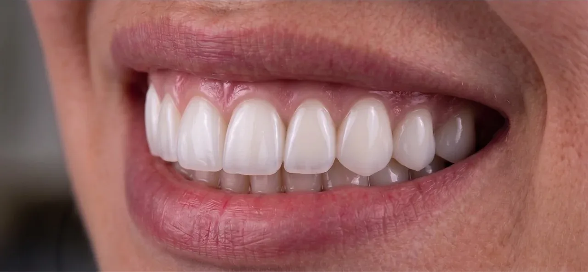

# Cruz3Design · Portfólio Digital

Portfólio de prótese dentária e planejamento digital, com galeria de trabalhos,
catálogo de serviços e contato direto.

**[Acessar o site](https://laisbraga1609.github.io/Portifolio-web/)**



## Recursos

- Layout responsivo para celular, tablet e computador.
- Busca e filtros por categoria.
- Galeria com visualização ampliada e navegação entre fotos.
- Fotos em WebP e miniaturas otimizadas.
- Contato por WhatsApp, e-mail e Instagram.
- Tabela de serviços e preços no fim da página.

## Sobre este repositório

Este repositório contém os arquivos estáticos da versão pública do site.
A edição do conteúdo é feita no painel local do projeto completo; uma nova
exportação atualiza os arquivos e o GitHub Pages publica a versão enviada.

A exportação atual inclui **10 trabalhos** e
**22 imagens**.

## Tecnologias

HTML, CSS, JavaScript, imagens WebP e GitHub Pages.
A exportação e a otimização das imagens são realizadas em Python com Pillow.

## Estrutura

```text
index.html           Página principal
css/style.css        Estilos e layouts responsivos
js/main.js           Menu, busca, filtros e galeria
js/portfolio-data.js  Conteúdo público exportado
uploads/             Fotos e miniaturas otimizadas
assets/              Identidade visual
```

O painel administrativo e o banco de dados não fazem parte desta hospedagem.
O contato está disponível pelos links apresentados no site.
